# Web Học Ngoại Ngữ — ERD & Database Design

> Baseline database design cho nền tảng học và luyện thi **IELTS + HSK**.
>
> Kiến trúc mục tiêu:
>
> ```text
> Next.js Frontend
>       ↓ REST / WebSocket
> NestJS Backend
>       ↓
> Supabase PostgreSQL
>       +
> Supabase Storage
> ```
>
> Database là **source of truth** cho dữ liệu nghiệp vụ. Frontend không truy cập trực tiếp các bảng nghiệp vụ quan trọng.

---

# 1. Mục tiêu thiết kế

Database phải hỗ trợ đầy đủ:

- Authentication / User Profile.
- Role / Permission.
- Language / Exam / ExamVersion.
- IELTS / HSK.
- Course / Module / Lesson.
- Learning Material.
- Enrollment / Course Access.
- Exercise / Question Bank.
- Test Builder / Test Engine.
- Placement / Diagnostic Assessment.
- Learning Goal / Learning Path / Study Plan.
- Progress.
- Vocabulary.
- Writing / Speaking Submission.
- Human Review.
- Package / Order / Payment / Coupon.
- CMS.
- Notification.
- Certificate.
- Media.
- Activity / Audit.
- AI extension.
- Analytics.

Thiết kế phải:

- Tránh hard-code IELTS / HSK.
- Giữ lịch sử Test/Result.
- Hỗ trợ versioning.
- Hỗ trợ idempotency.
- Có thể mở rộng JLPT / TOPIK.
- Tương thích PostgreSQL / Supabase.
- Không phụ thuộc Frontend implementation.

---

# 2. Quyết định kiến trúc Database

## 2.1 Database Platform

Baseline:

```text
Supabase PostgreSQL
```

Supabase được sử dụng như PostgreSQL hosting chính.

Backend NestJS truy cập PostgreSQL thông qua:

```text
NestJS
→ Repository / Data Access
→ Prisma hoặc PostgreSQL Client
→ Supabase PostgreSQL
```

Frontend không gọi trực tiếp các table nghiệp vụ cần business rule.

---

## 2.2 File Storage

Baseline:

```text
Supabase Storage
```

Dùng cho:

- Avatar.
- Course thumbnail.
- Article thumbnail.
- Lesson image.
- Video.
- Audio.
- Speaking recording.
- Downloadable resource.
- Certificate file.

Database **không lưu binary file**.

Database chỉ lưu:

```text
bucket
object_path
mime_type
size
visibility
owner
metadata
```

---

## 2.3 Authentication

Có hai phương án.

### Phương án A — Khuyến nghị khi muốn tận dụng Supabase

```text
Supabase Auth
+
public.users
```

`auth.users`:

- Supabase quản lý credential.
- Password.
- Email verification.
- Reset password.
- Auth provider.

`public.users`:

- Application profile.
- Learning information.
- Role relation.
- Preferences.

Quan hệ:

```text
auth.users.id
    1
    │
    │
    1
public.users.id
```

`public.users.id` dùng cùng UUID với `auth.users.id`.

### Phương án B — NestJS tự quản lý Auth

Backend tự có:

```text
users
password_credentials
refresh_tokens
```

Nếu chọn phương án này thì không dùng `auth.users` làm identity source.

> ERD baseline bên dưới ưu tiên **Phương án A — Supabase Auth**, vì mục tiêu của project là tận dụng Supabase cho tiện triển khai. Business authorization vẫn nằm ở NestJS.

---

# 3. Database Conventions

## 3.1 Naming

Table:

```text
snake_case
plural noun
```

Ví dụ:

```text
courses
test_attempts
learning_paths
```

Column:

```text
snake_case
```

Foreign key:

```text
<entity>_id
```

---

## 3.2 Primary Key

Sử dụng:

```sql
uuid
```

Default:

```sql
gen_random_uuid()
```

Ngoại lệ:

- bảng mapping có thể dùng composite unique constraint,
- nhưng vẫn có thể dùng UUID nếu cần audit/reference.

---

## 3.3 Timestamp

Dùng:

```sql
timestamptz
```

Các cột phổ biến:

```text
created_at
updated_at
deleted_at
published_at
completed_at
```

Database giữ UTC.

Timezone của user lưu riêng trong profile/preference.

---

## 3.4 Soft Delete

Các entity có lịch sử quan trọng ưu tiên:

```text
deleted_at nullable
```

Áp dụng cho:

- users.
- courses.
- modules.
- lessons.
- questions.
- tests.
- packages.
- articles.
- vocabulary_items.

Không hard-delete entity đã có historical result nếu không có migration/purge process.

---

## 3.5 Status

Status dùng:

```text
PostgreSQL ENUM
```

hoặc:

```text
varchar + CHECK
```

Baseline khuyến nghị enum ở application + CHECK/enum ở database cho các trạng thái ổn định.

---

## 3.6 Money

Không dùng float.

Dùng:

```sql
numeric(12,2)
```

và:

```text
currency char(3)
```

Ví dụ:

```text
VND
USD
```

---

## 3.7 Position

Các entity có ordering dùng:

```text
position integer
```

Unique trong parent khi hợp lý.

Ví dụ:

```text
(module_id, position)
(test_section_id, position)
```

---

## 3.8 Configuration

Cấu hình động dùng:

```sql
jsonb
```

Chỉ dùng JSONB cho:

- scoring config.
- question payload.
- exam config.
- UI-independent metadata.
- provider metadata.

Không dùng JSONB thay cho quan hệ relational rõ ràng.

---

# 4. Schema Groups

Database được chia logic thành các nhóm:

```text
IDENTITY
CATALOG
COURSE
QUESTION BANK
TEST ENGINE
ASSESSMENT
LEARNING PATH
PROGRESS
VOCABULARY
SUBMISSION / REVIEW
COMMERCE
CMS
MEDIA
NOTIFICATION
CERTIFICATE
ACTIVITY / AUDIT
AI / ANALYTICS
```

---

# 5. High-Level ERD

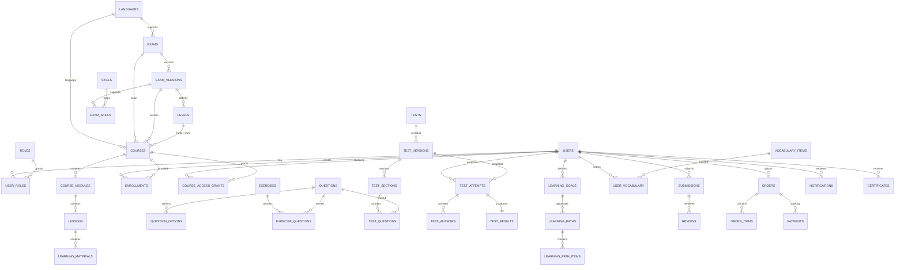

---

# 6. Identity & Access ERD

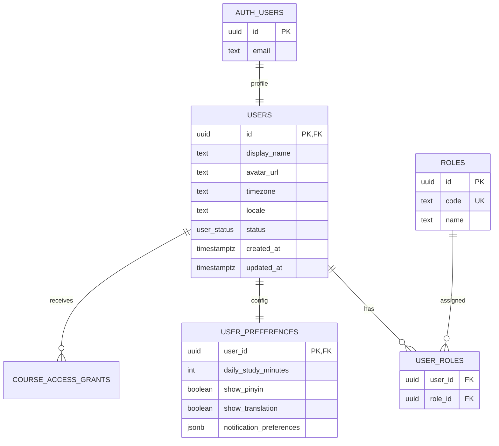

---

# 7. Identity Tables

## 7.1 `users`

Application profile.

Nếu dùng Supabase Auth:

```text
users.id = auth.users.id
```

Fields:

| Column | Type | Null | Note |
|---|---|---:|---|
| id | uuid | NO | PK, FK → auth.users.id |
| display_name | varchar(120) | NO | tên hiển thị |
| avatar_media_id | uuid | YES | FK → media_files |
| bio | text | YES | |
| timezone | varchar(64) | NO | default `UTC` |
| locale | varchar(16) | NO | `vi-VN`, `en-US`... |
| status | user_status | NO | ACTIVE/SUSPENDED... |
| last_active_at | timestamptz | YES | |
| created_at | timestamptz | NO | |
| updated_at | timestamptz | NO | |
| deleted_at | timestamptz | YES | soft delete |

Indexes:

```text
users(status)
users(last_active_at)
```

---

## 7.2 `roles`

| Column | Type | Note |
|---|---|---|
| id | uuid | PK |
| code | varchar(40) | UNIQUE |
| name | varchar(100) | |
| description | text | |
| is_system | boolean | |

Seed:

```text
STUDENT
ADMIN
CONTENT_MANAGER
REVIEWER
```

---

## 7.3 `user_roles`

| Column | Type | Note |
|---|---|---|
| user_id | uuid | FK → users |
| role_id | uuid | FK → roles |
| granted_by | uuid | FK → users, nullable |
| granted_at | timestamptz | |
| expires_at | timestamptz | nullable |

Unique:

```text
(user_id, role_id)
```

---

## 7.4 `user_preferences`

| Column | Type | Note |
|---|---|---|
| user_id | uuid | PK/FK |
| daily_study_minutes | int | |
| preferred_study_time | time | nullable |
| audio_autoplay | boolean | |
| show_pinyin | boolean | HSK |
| show_translation | boolean | |
| notification_preferences | jsonb | |
| learning_preferences | jsonb | |
| updated_at | timestamptz | |

---

# 8. Language / Exam Catalog ERD

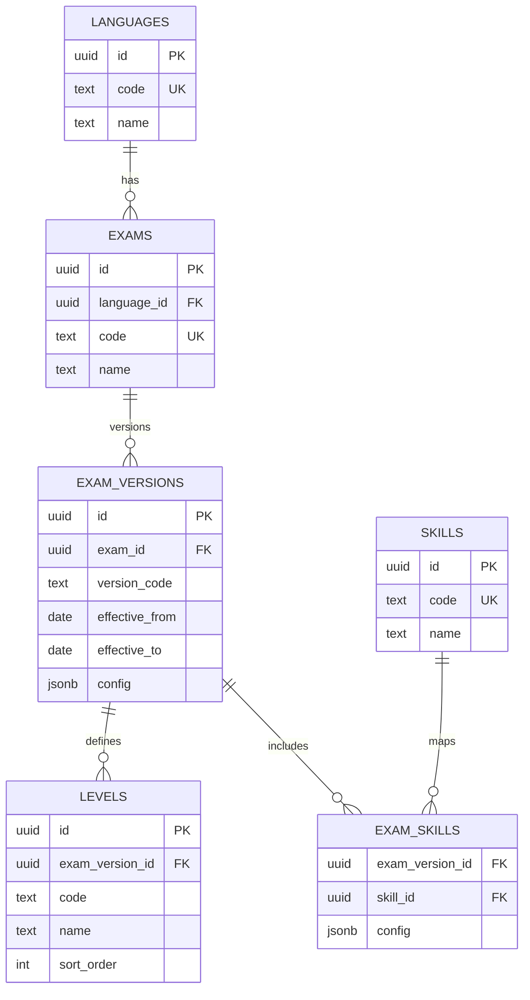

---

# 9. Catalog Tables

## 9.1 `languages`

| Column | Type | Note |
|---|---|---|
| id | uuid | PK |
| code | varchar(10) | UNIQUE: `en`, `zh` |
| name | varchar(100) | English, Chinese |
| native_name | varchar(100) | |
| is_active | boolean | |

Seed:

```text
en — English
zh — Chinese
```

---

## 9.2 `exams`

| Column | Type | Note |
|---|---|---|
| id | uuid | PK |
| language_id | uuid | FK |
| code | varchar(30) | UNIQUE |
| name | varchar(120) | |
| description | text | |
| is_active | boolean | |

Seed:

```text
IELTS
HSK
```

---

## 9.3 `exam_versions`

| Column | Type | Note |
|---|---|---|
| id | uuid | PK |
| exam_id | uuid | FK |
| version_code | varchar(50) | |
| name | varchar(120) | |
| effective_from | date | nullable |
| effective_to | date | nullable |
| config | jsonb | exam-specific config |
| scoring_config | jsonb | conversion/scoring |
| is_active | boolean | |
| created_at | timestamptz | |

Unique:

```text
(exam_id, version_code)
```

Không hard-code HSK/IELTS format ở Frontend.

---

## 9.4 `levels`

| Column | Type | Note |
|---|---|---|
| id | uuid | PK |
| exam_version_id | uuid | FK |
| code | varchar(50) | |
| name | varchar(100) | |
| description | text | |
| sort_order | int | |
| min_score | numeric(6,2) | nullable |
| max_score | numeric(6,2) | nullable |
| metadata | jsonb | |

Unique:

```text
(exam_version_id, code)
```

Ví dụ:

```text
IELTS: FOUNDATION / 4.0 / 5.0 / 6.0 / 6.5 / 7.0
HSK: HSK1 / HSK2 / ...
```

---

## 9.5 `skills`

Generic skill catalog.

| Column | Type |
|---|---|
| id | uuid |
| code | varchar(30) UNIQUE |
| name | varchar(100) |
| description | text |

Seed:

```text
LISTENING
READING
WRITING
SPEAKING
VOCABULARY
GRAMMAR
```

---

## 9.6 `exam_skills`

Mapping ExamVersion → Skill.

| Column | Type |
|---|---|
| exam_version_id | uuid |
| skill_id | uuid |
| sort_order | int |
| config | jsonb |

Unique:

```text
(exam_version_id, skill_id)
```

---

# 10. Course ERD

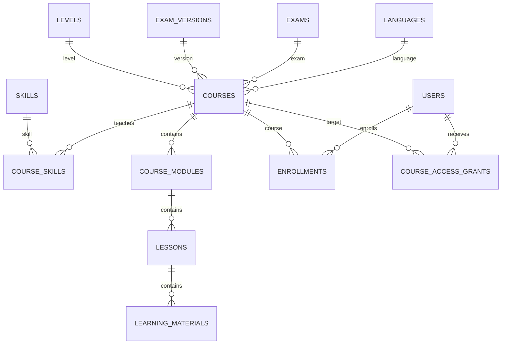

---

# 11. Course Tables

## 11.1 `courses`

| Column | Type | Note |
|---|---|---|
| id | uuid | PK |
| language_id | uuid | FK |
| exam_id | uuid | nullable FK |
| exam_version_id | uuid | nullable FK |
| level_id | uuid | nullable FK |
| title | varchar(200) | |
| slug | varchar(220) | UNIQUE |
| short_description | varchar(500) | |
| description | text | |
| thumbnail_media_id | uuid | nullable FK |
| course_type | course_type | FOUNDATION/SKILL/... |
| status | content_status | DRAFT/PUBLISHED/... |
| price | numeric(12,2) | nullable |
| currency | char(3) | |
| is_free | boolean | |
| trial_enabled | boolean | |
| estimated_minutes | int | nullable |
| published_at | timestamptz | nullable |
| created_by | uuid | FK users |
| created_at | timestamptz | |
| updated_at | timestamptz | |
| deleted_at | timestamptz | |

Indexes:

```text
courses(language_id, status)
courses(exam_id, status)
courses(level_id, status)
courses(slug) UNIQUE
courses(published_at)
```

---

## 11.2 `course_skills`

Many-to-many.

```text
course_id
skill_id
is_primary
weight
```

Unique:

```text
(course_id, skill_id)
```

---

## 11.3 `course_modules`

> Tên table dùng `course_modules` để tránh nhầm với Backend NestJS module.

| Column | Type |
|---|---|
| id | uuid |
| course_id | uuid |
| title | varchar(200) |
| description | text |
| position | int |
| status | content_status |
| estimated_minutes | int |
| created_at | timestamptz |
| updated_at | timestamptz |
| deleted_at | timestamptz |

Unique active ordering:

```text
(course_id, position)
```

---

## 11.4 `lessons`

| Column | Type |
|---|---|
| id | uuid |
| course_module_id | uuid |
| title | varchar(200) |
| slug | varchar(220) |
| description | text |
| lesson_type | lesson_type |
| position | int |
| status | content_status |
| is_preview | boolean |
| estimated_minutes | int |
| completion_policy | jsonb |
| published_at | timestamptz |
| created_at | timestamptz |
| updated_at | timestamptz |
| deleted_at | timestamptz |

Unique:

```text
(course_module_id, position)
(course_module_id, slug)
```

---

## 11.5 `learning_materials`

| Column | Type | Note |
|---|---|---|
| id | uuid | |
| lesson_id | uuid | |
| material_type | material_type | VIDEO/AUDIO/TEXT... |
| title | varchar(200) | |
| position | int | |
| content | jsonb | structured content |
| media_file_id | uuid | nullable |
| is_required | boolean | |
| estimated_minutes | int | |
| status | content_status | |
| created_at | timestamptz | |
| updated_at | timestamptz | |

---

## 11.6 `enrollments`

Enrollment là participation record.

| Column | Type |
|---|---|
| id | uuid |
| user_id | uuid |
| course_id | uuid |
| enrolled_at | timestamptz |
| enrollment_source | enrollment_source |
| status | enrollment_status |
| completed_at | timestamptz |
| created_at | timestamptz |

Unique active:

```text
(user_id, course_id)
```

---

## 11.7 `course_access_grants`

Nguồn canonical cho quyền truy cập Course.

| Column | Type | Note |
|---|---|---|
| id | uuid | |
| user_id | uuid | |
| course_id | uuid | |
| source_type | access_source | PURCHASE/PACKAGE/TRIAL/ADMIN |
| source_id | uuid | nullable |
| starts_at | timestamptz | |
| expires_at | timestamptz | nullable |
| revoked_at | timestamptz | nullable |
| revoked_by | uuid | nullable |
| metadata | jsonb | |
| created_at | timestamptz | |

Index:

```text
(user_id, course_id, expires_at, revoked_at)
```

---

# 12. Question Bank ERD

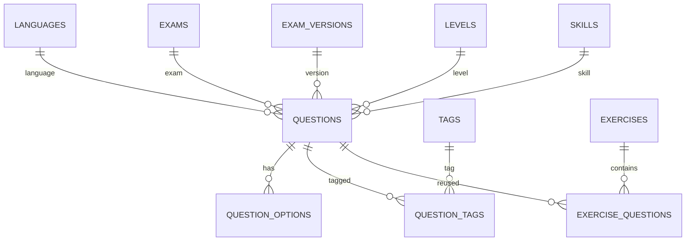

---

# 13. Question Bank Tables

## 13.1 `questions`

| Column | Type | Note |
|---|---|---|
| id | uuid | |
| language_id | uuid | |
| exam_id | uuid | nullable |
| exam_version_id | uuid | nullable |
| level_id | uuid | nullable |
| skill_id | uuid | nullable |
| question_type | question_type | |
| difficulty | difficulty | |
| prompt | text | |
| content | jsonb | structured payload |
| answer_key | jsonb | SERVER ONLY |
| explanation | jsonb | |
| audio_media_id | uuid | nullable |
| image_media_id | uuid | nullable |
| target_score_min | numeric(6,2) | nullable |
| target_score_max | numeric(6,2) | nullable |
| status | content_status | |
| version | int | |
| created_by | uuid | |
| created_at | timestamptz | |
| updated_at | timestamptz | |
| archived_at | timestamptz | |

Indexes:

```text
questions(exam_id, skill_id, question_type)
questions(level_id, difficulty)
questions(status)
```

Security:

```text
answer_key
```

không được serialize vào Student API trước thời điểm policy cho phép.

---

## 13.2 `question_options`

Dùng cho question type có option.

| Column | Type |
|---|---|
| id | uuid |
| question_id | uuid |
| option_key | varchar(20) |
| content | jsonb |
| position | int |
| is_correct | boolean |
| metadata | jsonb |

Unique:

```text
(question_id, option_key)
```

`is_correct` chỉ Backend được đọc trong learning/test flow.

---

## 13.3 `tags`

Generic content tags.

| Column | Type |
|---|---|
| id | uuid |
| slug | varchar(100) UNIQUE |
| name | varchar(100) |
| tag_type | varchar(30) |

---

## 13.4 `question_tags`

```text
question_id
tag_id
```

Unique:

```text
(question_id, tag_id)
```

---

# 14. Exercise Tables

## 14.1 `exercises`

| Column | Type |
|---|---|
| id | uuid |
| lesson_id | uuid nullable |
| title | varchar(200) |
| exercise_type | exercise_type |
| instructions | text |
| pass_score | numeric(6,2) nullable |
| max_attempts | int nullable |
| shuffle_questions | boolean |
| show_explanation_policy | varchar(30) |
| status | content_status |
| created_at | timestamptz |
| updated_at | timestamptz |

---

## 14.2 `exercise_questions`

| Column | Type |
|---|---|
| exercise_id | uuid |
| question_id | uuid |
| position | int |
| points | numeric(8,2) |
| config | jsonb |

Unique:

```text
(exercise_id, question_id)
(exercise_id, position)
```

---

## 14.3 `exercise_attempts`

| Column | Type |
|---|---|
| id | uuid |
| exercise_id | uuid |
| user_id | uuid |
| attempt_no | int |
| status | attempt_status |
| started_at | timestamptz |
| submitted_at | timestamptz |
| raw_score | numeric(10,2) |
| max_score | numeric(10,2) |
| percentage | numeric(6,2) |
| passed | boolean |
| created_at | timestamptz |

Unique:

```text
(exercise_id, user_id, attempt_no)
```

---

## 14.4 `exercise_answers`

| Column | Type |
|---|---|
| id | uuid |
| exercise_attempt_id | uuid |
| question_id | uuid |
| answer | jsonb |
| is_correct | boolean nullable |
| score | numeric(10,2) nullable |
| answered_at | timestamptz |

Unique:

```text
(exercise_attempt_id, question_id)
```

---

# 15. Test Engine ERD

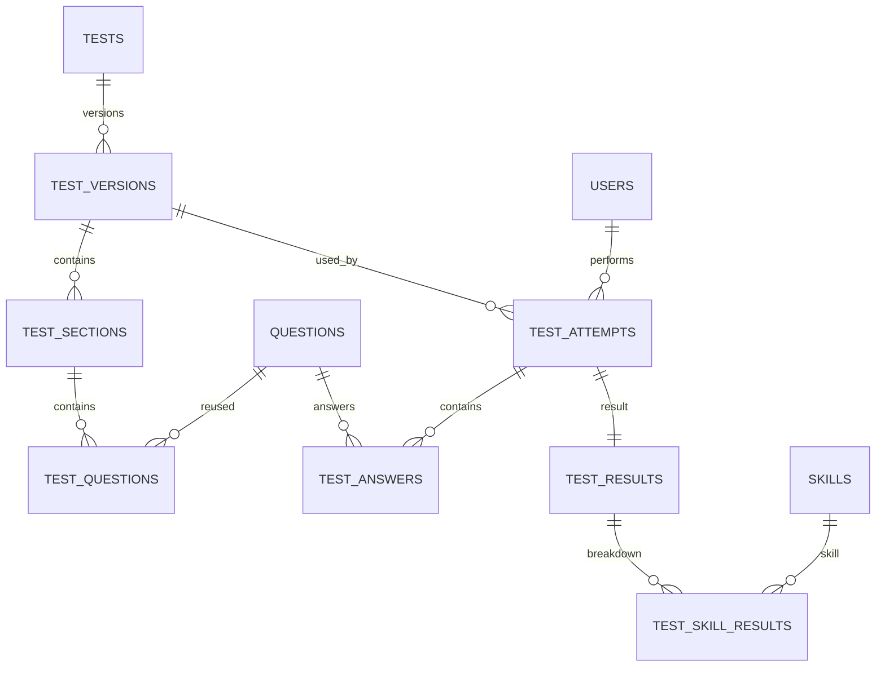

---

# 16. Test Tables

## 16.1 `tests`

Logical Test.

| Column | Type |
|---|---|
| id | uuid |
| exam_id | uuid nullable |
| title | varchar(200) |
| slug | varchar(220) |
| test_type | test_type |
| description | text |
| status | content_status |
| current_version_id | uuid nullable |
| created_by | uuid |
| created_at | timestamptz |
| updated_at | timestamptz |
| archived_at | timestamptz |

---

## 16.2 `test_versions`

Immutable published snapshot.

| Column | Type |
|---|---|
| id | uuid |
| test_id | uuid |
| exam_version_id | uuid nullable |
| version_no | int |
| duration_seconds | int nullable |
| max_attempts | int nullable |
| scoring_config | jsonb |
| delivery_config | jsonb |
| status | version_status |
| published_at | timestamptz |
| published_by | uuid |
| created_at | timestamptz |

Unique:

```text
(test_id, version_no)
```

Published version không sửa trực tiếp.

---

## 16.3 `test_sections`

| Column | Type |
|---|---|
| id | uuid |
| test_version_id | uuid |
| skill_id | uuid nullable |
| title | varchar(200) |
| instructions | text |
| position | int |
| duration_seconds | int nullable |
| config | jsonb |

Unique:

```text
(test_version_id, position)
```

---

## 16.4 `test_questions`

| Column | Type |
|---|---|
| id | uuid |
| test_section_id | uuid |
| question_id | uuid |
| position | int |
| points | numeric(8,2) |
| snapshot | jsonb |
| config | jsonb |

`snapshot` giữ nội dung cần thiết để bảo toàn lịch sử nếu Question master thay đổi.

Unique:

```text
(test_section_id, position)
```

---

## 16.5 `test_attempts`

| Column | Type |
|---|---|
| id | uuid |
| test_version_id | uuid |
| user_id | uuid |
| attempt_no | int |
| status | test_attempt_status |
| started_at | timestamptz |
| expires_at | timestamptz nullable |
| submitted_at | timestamptz nullable |
| finalized_at | timestamptz nullable |
| submission_key | varchar(120) nullable |
| metadata | jsonb |
| created_at | timestamptz |

Unique:

```text
(test_version_id, user_id, attempt_no)
submission_key UNIQUE WHERE NOT NULL
```

---

## 16.6 `test_answers`

| Column | Type |
|---|---|
| id | uuid |
| test_attempt_id | uuid |
| test_question_id | uuid |
| answer | jsonb |
| answer_text | text nullable |
| media_file_id | uuid nullable |
| status | answer_status |
| auto_score | numeric(10,2) nullable |
| manual_score | numeric(10,2) nullable |
| final_score | numeric(10,2) nullable |
| answered_at | timestamptz |
| updated_at | timestamptz |

Unique:

```text
(test_attempt_id, test_question_id)
```

---

## 16.7 `test_results`

One finalized summary per attempt.

| Column | Type |
|---|---|
| id | uuid |
| test_attempt_id | uuid UNIQUE |
| raw_score | numeric(10,2) |
| max_score | numeric(10,2) |
| percentage | numeric(6,2) |
| estimated_score | numeric(6,2) nullable |
| estimated_level_id | uuid nullable |
| passed | boolean nullable |
| result_data | jsonb |
| status | result_status |
| calculated_at | timestamptz |
| finalized_at | timestamptz nullable |

Finalized result phải immutable ở normal flow.

---

## 16.8 `test_skill_results`

| Column | Type |
|---|---|
| id | uuid |
| test_result_id | uuid |
| skill_id | uuid |
| raw_score | numeric(10,2) |
| max_score | numeric(10,2) |
| percentage | numeric(6,2) |
| estimated_score | numeric(6,2) nullable |
| level_id | uuid nullable |
| metadata | jsonb |

Unique:

```text
(test_result_id, skill_id)
```

---

# 17. Assessment ERD

Placement / Diagnostic **reuse Test Engine**.

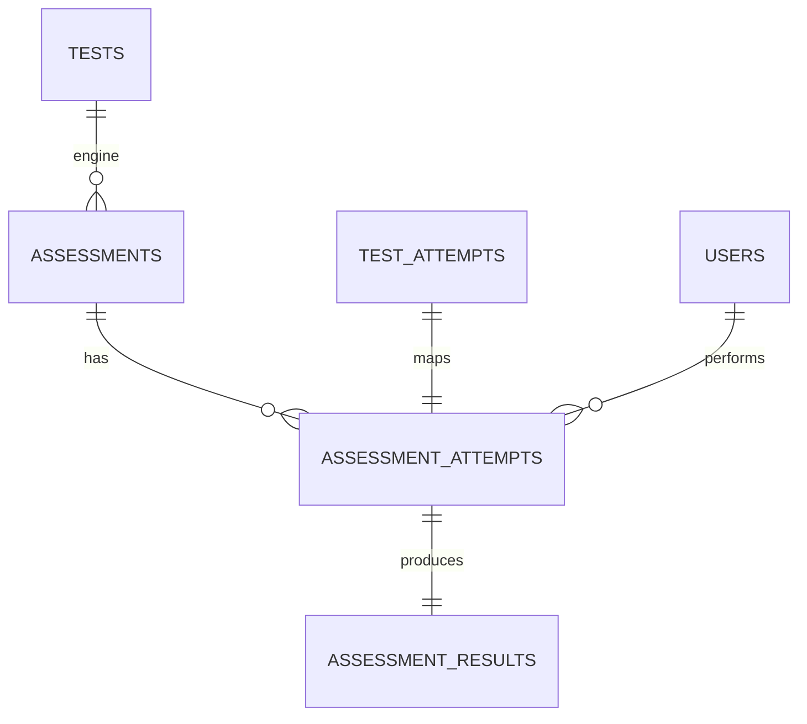

---

# 18. Assessment Tables

## 18.1 `assessments`

| Column | Type |
|---|---|
| id | uuid |
| test_id | uuid |
| exam_id | uuid |
| assessment_type | assessment_type |
| name | varchar(200) |
| retake_policy | jsonb |
| result_policy | jsonb |
| is_active | boolean |
| created_at | timestamptz |

Types:

```text
PLACEMENT
DIAGNOSTIC
```

---

## 18.2 `assessment_attempts`

| Column | Type |
|---|---|
| id | uuid |
| assessment_id | uuid |
| user_id | uuid |
| test_attempt_id | uuid UNIQUE |
| created_at | timestamptz |

---

## 18.3 `assessment_results`

| Column | Type |
|---|---|
| id | uuid |
| assessment_attempt_id | uuid UNIQUE |
| estimated_level_id | uuid nullable |
| estimated_overall | numeric(6,2) nullable |
| strengths | jsonb |
| weak_skills | jsonb |
| learning_gaps | jsonb |
| recommendation_data | jsonb |
| finalized_at | timestamptz |

---

# 19. Learning Goal & Path ERD

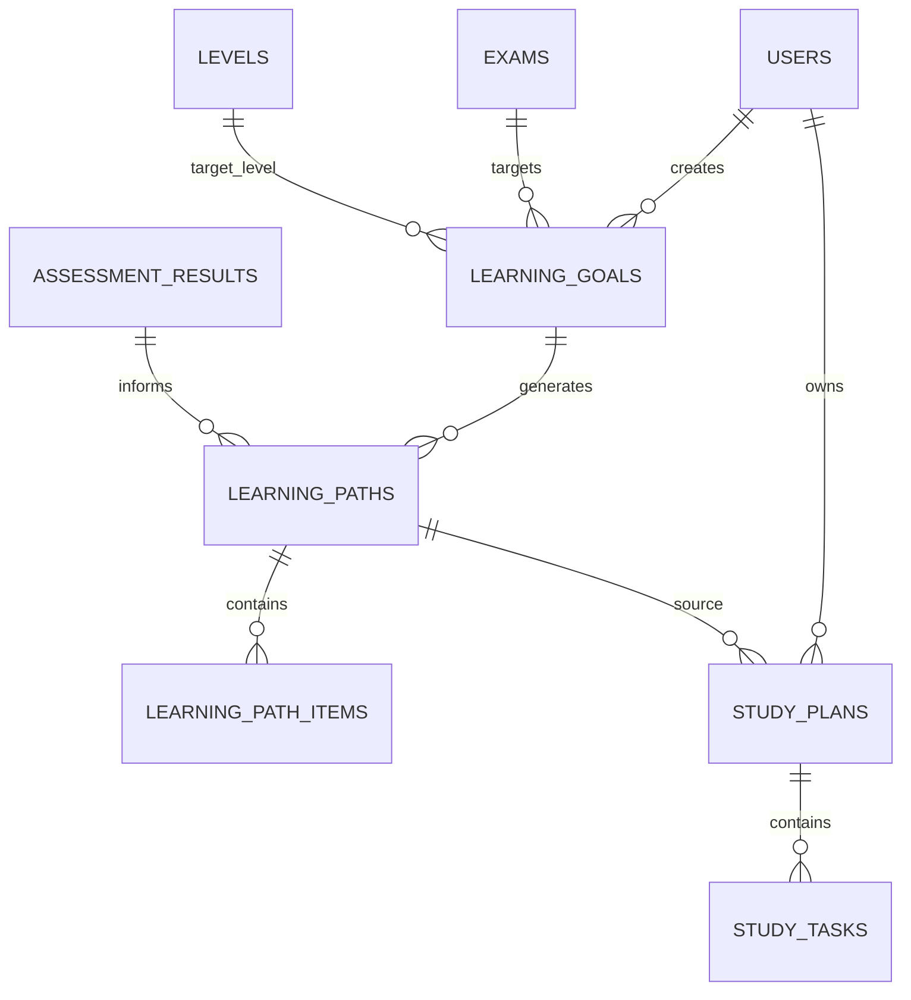

---

# 20. Learning Goal Tables

## 20.1 `learning_goals`

| Column | Type |
|---|---|
| id | uuid |
| user_id | uuid |
| language_id | uuid |
| exam_id | uuid nullable |
| current_level_id | uuid nullable |
| target_level_id | uuid nullable |
| target_score | numeric(6,2) nullable |
| target_date | date nullable |
| daily_study_minutes | int nullable |
| status | goal_status |
| created_at | timestamptz |
| updated_at | timestamptz |
| completed_at | timestamptz nullable |

Index:

```text
(user_id, status)
```

Business rule:

Một context chỉ nên có một active primary goal theo policy.

---

## 20.2 `learning_goal_skills`

Optional skill targets.

```text
learning_goal_id
skill_id
target_score
priority
```

---

## 20.3 `learning_paths`

| Column | Type |
|---|---|
| id | uuid |
| user_id | uuid |
| learning_goal_id | uuid |
| assessment_result_id | uuid nullable |
| version_no | int |
| status | path_status |
| generated_by | generated_by |
| generated_at | timestamptz |
| metadata | jsonb |

Unique:

```text
(learning_goal_id, version_no)
```

---

## 20.4 `learning_path_items`

| Column | Type |
|---|---|
| id | uuid |
| learning_path_id | uuid |
| item_type | path_item_type |
| course_id | uuid nullable |
| lesson_id | uuid nullable |
| exercise_id | uuid nullable |
| test_id | uuid nullable |
| title | varchar(200) |
| position | int |
| status | path_item_status |
| estimated_minutes | int |
| prerequisite_item_id | uuid nullable |
| metadata | jsonb |

---

## 20.5 `study_plans`

| Column | Type |
|---|---|
| id | uuid |
| user_id | uuid |
| learning_path_id | uuid nullable |
| start_date | date |
| end_date | date |
| status | study_plan_status |
| created_at | timestamptz |
| updated_at | timestamptz |

---

## 20.6 `study_tasks`

| Column | Type |
|---|---|
| id | uuid |
| study_plan_id | uuid |
| task_date | date |
| task_type | study_task_type |
| reference_type | varchar(30) |
| reference_id | uuid nullable |
| title | varchar(200) |
| estimated_minutes | int |
| status | study_task_status |
| completed_at | timestamptz nullable |
| position | int |

Index:

```text
(study_plan_id, task_date)
```

---

# 21. Progress ERD

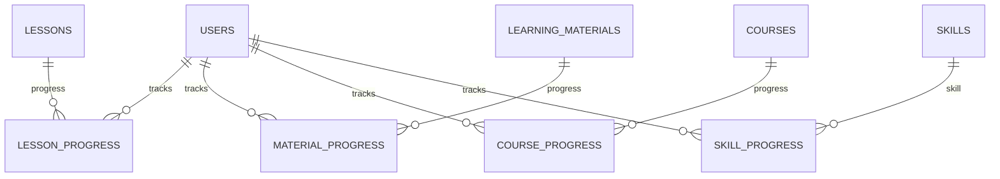

---

# 22. Progress Tables

## 22.1 `lesson_progress`

| Column | Type |
|---|---|
| id | uuid |
| user_id | uuid |
| lesson_id | uuid |
| status | progress_status |
| progress_percent | numeric(5,2) |
| started_at | timestamptz |
| last_accessed_at | timestamptz |
| completed_at | timestamptz nullable |
| version | int |

Unique:

```text
(user_id, lesson_id)
```

---

## 22.2 `material_progress`

```text
user_id
learning_material_id
status
progress_percent
position_seconds
completed_at
updated_at
```

Unique:

```text
(user_id, learning_material_id)
```

---

## 22.3 `course_progress`

Cached/materialized application progress.

| Column | Type |
|---|---|
| user_id | uuid |
| course_id | uuid |
| progress_percent | numeric(5,2) |
| completed_lessons | int |
| total_lessons | int |
| status | progress_status |
| started_at | timestamptz |
| completed_at | timestamptz |
| updated_at | timestamptz |

Unique:

```text
(user_id, course_id)
```

Canonical detail vẫn đến từ lesson/material/result data.

---

## 22.4 `skill_progress`

| Column | Type |
|---|---|
| id | uuid |
| user_id | uuid |
| exam_id | uuid nullable |
| skill_id | uuid |
| current_estimate | numeric(6,2) nullable |
| accuracy_percent | numeric(5,2) nullable |
| sample_count | int |
| updated_at | timestamptz |

Unique:

```text
(user_id, exam_id, skill_id)
```

---

## 22.5 `progress_events`

Idempotent learning-event ledger.

| Column | Type |
|---|---|
| id | uuid |
| user_id | uuid |
| event_type | varchar(50) |
| entity_type | varchar(40) |
| entity_id | uuid |
| event_key | varchar(160) UNIQUE |
| payload | jsonb |
| occurred_at | timestamptz |
| created_at | timestamptz |

Dùng để chống duplicate progress update.

---

# 23. Vocabulary ERD

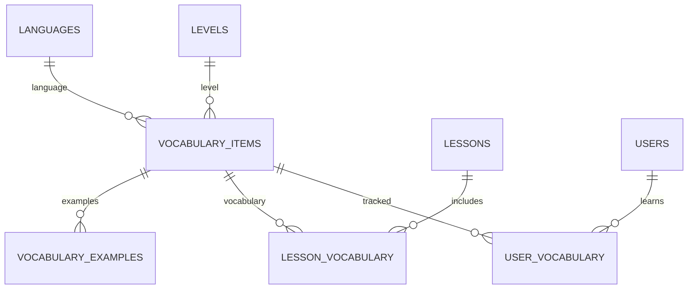

---

# 24. Vocabulary Tables

## 24.1 `vocabulary_items`

| Column | Type |
|---|---|
| id | uuid |
| language_id | uuid |
| level_id | uuid nullable |
| term | varchar(255) |
| hanzi | varchar(255) nullable |
| pinyin | varchar(255) nullable |
| phonetic | varchar(255) nullable |
| meaning | text |
| audio_media_id | uuid nullable |
| part_of_speech | varchar(50) nullable |
| metadata | jsonb |
| status | content_status |
| created_at | timestamptz |
| updated_at | timestamptz |

Indexes:

```text
(language_id, term)
(level_id)
```

---

## 24.2 `vocabulary_examples`

| Column | Type |
|---|---|
| id | uuid |
| vocabulary_id | uuid |
| example_text | text |
| example_pinyin | text nullable |
| translation | text nullable |
| audio_media_id | uuid nullable |
| position | int |

---

## 24.3 `lesson_vocabulary`

```text
lesson_id
vocabulary_id
position
is_required
```

---

## 24.4 `user_vocabulary`

| Column | Type |
|---|---|
| id | uuid |
| user_id | uuid |
| vocabulary_id | uuid |
| state | vocabulary_state |
| mastery_score | numeric(5,2) |
| last_reviewed_at | timestamptz |
| next_review_at | timestamptz nullable |
| review_count | int |
| correct_count | int |
| incorrect_count | int |
| created_at | timestamptz |
| updated_at | timestamptz |

Unique:

```text
(user_id, vocabulary_id)
```

States:

```text
NEW
LEARNING
REVIEW
MASTERED
```

---

## 24.5 `vocabulary_practice_attempts`

| Column | Type |
|---|---|
| id | uuid |
| user_id | uuid |
| practice_type | varchar(30) |
| started_at | timestamptz |
| completed_at | timestamptz |
| score | numeric(6,2) |
| metadata | jsonb |

---

# 25. Submission & Review ERD

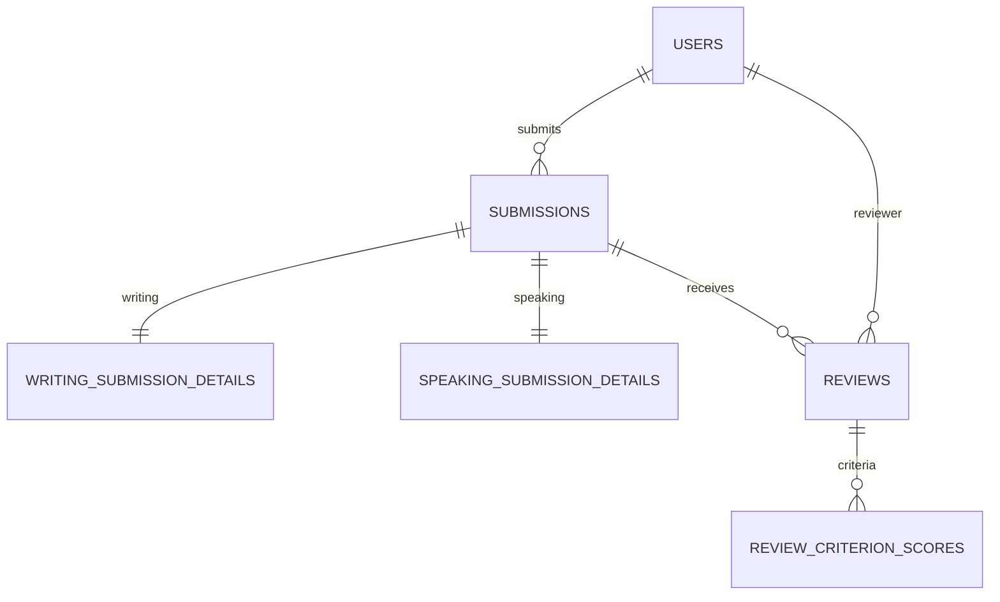

---

# 26. Submission Tables

## 26.1 `submissions`

Generic base.

| Column | Type |
|---|---|
| id | uuid |
| user_id | uuid |
| submission_type | submission_type |
| source_type | varchar(40) |
| source_id | uuid |
| status | submission_status |
| attempt_no | int |
| submitted_at | timestamptz nullable |
| returned_at | timestamptz nullable |
| reviewed_at | timestamptz nullable |
| published_at | timestamptz nullable |
| created_at | timestamptz |
| updated_at | timestamptz |

States:

```text
DRAFT
SUBMITTED
UNDER_REVIEW
RETURNED
REVIEWED
PUBLISHED
```

---

## 26.2 `writing_submission_details`

| Column | Type |
|---|---|
| submission_id | uuid PK/FK |
| prompt_snapshot | jsonb |
| answer_text | text |
| word_count | int |
| draft_saved_at | timestamptz |

---

## 26.3 `speaking_submission_details`

| Column | Type |
|---|---|
| submission_id | uuid PK/FK |
| prompt_snapshot | jsonb |
| audio_media_id | uuid |
| duration_seconds | int |
| transcript | text nullable |

---

## 26.4 `reviews`

| Column | Type |
|---|---|
| id | uuid |
| submission_id | uuid |
| reviewer_id | uuid |
| status | review_status |
| overall_score | numeric(6,2) nullable |
| overall_feedback | text |
| strengths | text nullable |
| improvements | text nullable |
| review_version | int |
| is_current | boolean |
| created_at | timestamptz |
| published_at | timestamptz nullable |

Index:

```text
(submission_id, is_current)
(reviewer_id, status)
```

---

## 26.5 `review_criterion_scores`

| Column | Type |
|---|---|
| id | uuid |
| review_id | uuid |
| criterion_code | varchar(80) |
| score | numeric(6,2) |
| feedback | text |
| metadata | jsonb |

Unique:

```text
(review_id, criterion_code)
```

---

# 27. Commerce ERD

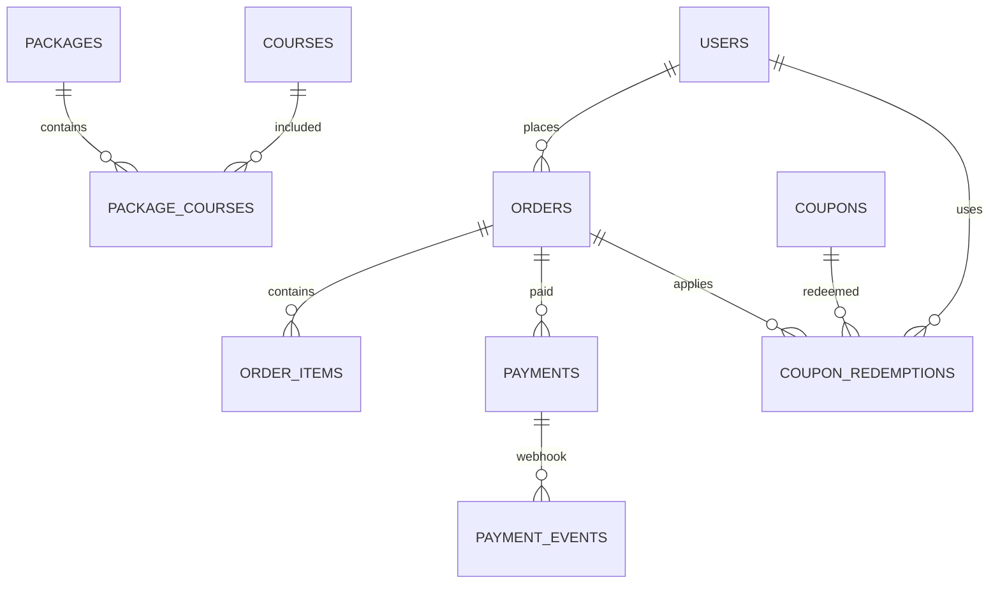

---

# 28. Commerce Tables

## 28.1 `packages`

| Column | Type |
|---|---|
| id | uuid |
| title | varchar(200) |
| slug | varchar(220) UNIQUE |
| description | text |
| package_type | package_type |
| price | numeric(12,2) |
| currency | char(3) |
| access_duration_days | int nullable |
| status | content_status |
| published_at | timestamptz |
| created_at | timestamptz |
| updated_at | timestamptz |

---

## 28.2 `package_courses`

```text
package_id
course_id
position
```

Unique:

```text
(package_id, course_id)
```

---

## 28.3 `orders`

| Column | Type |
|---|---|
| id | uuid |
| user_id | uuid |
| order_number | varchar(40) UNIQUE |
| status | order_status |
| subtotal | numeric(12,2) |
| discount_total | numeric(12,2) |
| total | numeric(12,2) |
| currency | char(3) |
| placed_at | timestamptz |
| paid_at | timestamptz nullable |
| completed_at | timestamptz nullable |
| canceled_at | timestamptz nullable |
| metadata | jsonb |
| created_at | timestamptz |
| updated_at | timestamptz |

---

## 28.4 `order_items`

Snapshot giá tại checkout.

| Column | Type |
|---|---|
| id | uuid |
| order_id | uuid |
| item_type | order_item_type |
| course_id | uuid nullable |
| package_id | uuid nullable |
| title_snapshot | varchar(200) |
| unit_price | numeric(12,2) |
| discount_amount | numeric(12,2) |
| final_price | numeric(12,2) |
| quantity | int |
| metadata | jsonb |

---

## 28.5 `payments`

| Column | Type |
|---|---|
| id | uuid |
| order_id | uuid |
| provider | varchar(40) |
| provider_transaction_id | varchar(160) nullable |
| idempotency_key | varchar(160) nullable |
| status | payment_status |
| amount | numeric(12,2) |
| currency | char(3) |
| payment_method | varchar(50) nullable |
| paid_at | timestamptz nullable |
| failed_at | timestamptz nullable |
| provider_metadata | jsonb |
| created_at | timestamptz |
| updated_at | timestamptz |

Unique:

```text
(provider, provider_transaction_id)
idempotency_key
```

---

## 28.6 `payment_events`

Webhook ledger.

| Column | Type |
|---|---|
| id | uuid |
| provider | varchar(40) |
| provider_event_id | varchar(160) |
| event_type | varchar(100) |
| payload | jsonb |
| signature_verified | boolean |
| processed_at | timestamptz nullable |
| processing_error | text nullable |
| received_at | timestamptz |

Unique:

```text
(provider, provider_event_id)
```

---

## 28.7 `coupons`

| Column | Type |
|---|---|
| id | uuid |
| code | varchar(80) UNIQUE |
| discount_type | discount_type |
| discount_value | numeric(12,2) |
| min_order_amount | numeric(12,2) nullable |
| max_discount_amount | numeric(12,2) nullable |
| starts_at | timestamptz |
| ends_at | timestamptz |
| usage_limit | int nullable |
| per_user_limit | int nullable |
| status | coupon_status |
| rules | jsonb |
| created_at | timestamptz |

---

## 28.8 `coupon_redemptions`

```text
id
coupon_id
user_id
order_id
discount_amount
redeemed_at
```

Unique:

```text
(coupon_id, order_id)
```

---

# 29. CMS ERD

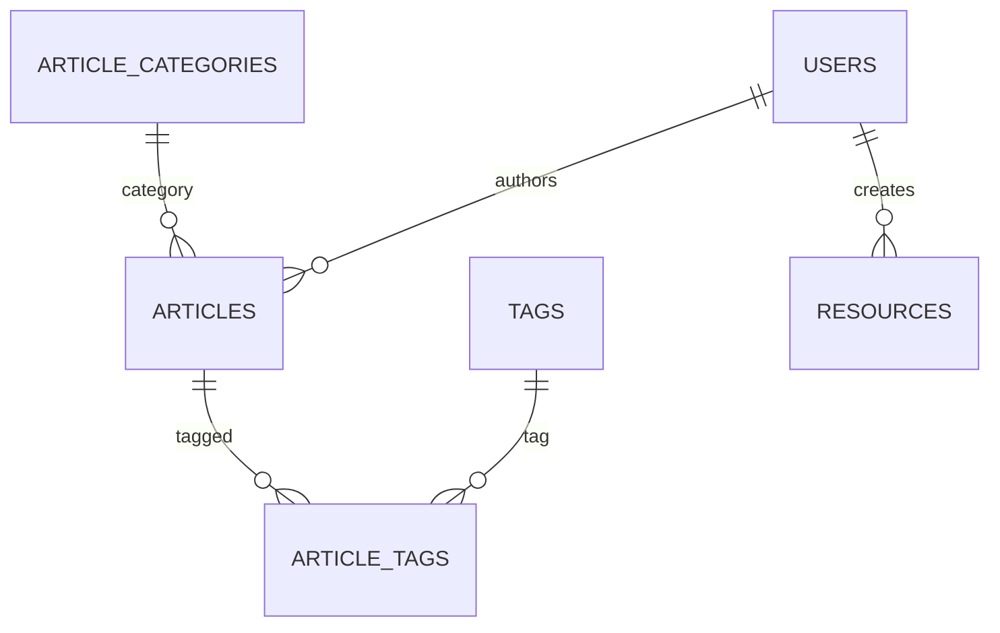

---

# 30. CMS Tables

## 30.1 `article_categories`

```text
id
name
slug
language_id
description
is_active
```

---

## 30.2 `articles`

| Column | Type |
|---|---|
| id | uuid |
| category_id | uuid nullable |
| language_id | uuid nullable |
| author_id | uuid |
| title | varchar(250) |
| slug | varchar(260) UNIQUE |
| excerpt | text |
| content | jsonb |
| thumbnail_media_id | uuid nullable |
| status | content_status |
| seo_title | varchar(255) |
| seo_description | varchar(320) |
| published_at | timestamptz |
| created_at | timestamptz |
| updated_at | timestamptz |
| deleted_at | timestamptz |

---

## 30.3 `article_tags`

```text
article_id
tag_id
```

---

## 30.4 `resources`

| Column | Type |
|---|---|
| id | uuid |
| language_id | uuid nullable |
| title | varchar(220) |
| slug | varchar(240) UNIQUE |
| resource_type | varchar(50) |
| description | text |
| media_file_id | uuid nullable |
| external_url | text nullable |
| status | content_status |
| is_free | boolean |
| created_by | uuid |
| published_at | timestamptz |
| created_at | timestamptz |

---

# 31. Media ERD

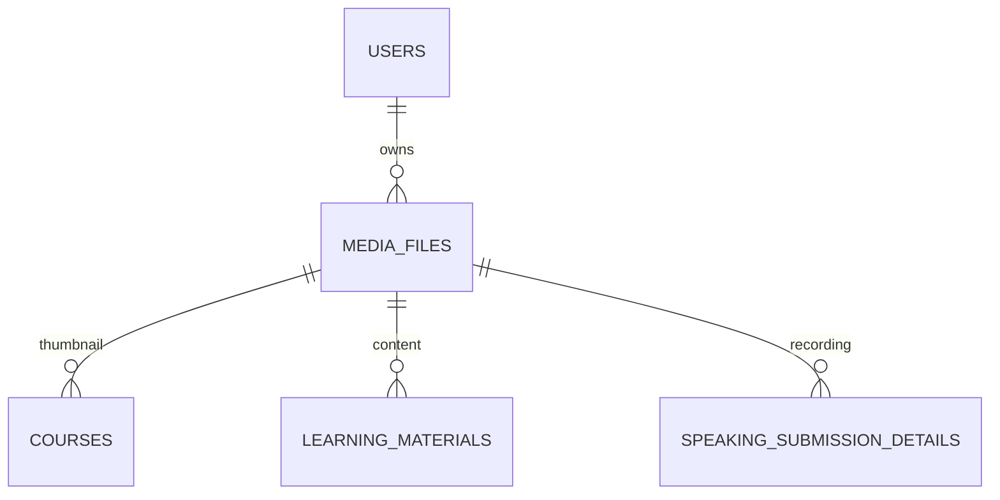

---

# 32. Media Table

## `media_files`

| Column | Type |
|---|---|
| id | uuid |
| owner_user_id | uuid nullable |
| bucket | varchar(100) |
| object_path | text |
| original_name | text |
| mime_type | varchar(150) |
| size_bytes | bigint |
| media_type | media_type |
| visibility | media_visibility |
| checksum | varchar(128) nullable |
| duration_seconds | int nullable |
| width | int nullable |
| height | int nullable |
| metadata | jsonb |
| status | media_status |
| created_at | timestamptz |
| deleted_at | timestamptz nullable |

Unique:

```text
(bucket, object_path)
```

---

# 33. Supabase Storage Buckets

Khuyến nghị:

```text
avatars
public-content
lesson-media
speaking-submissions
resources
certificates
```

## `avatars`

```text
Public hoặc signed
Image only
Per-user prefix
```

Path:

```text
users/{user_id}/avatar/{file}
```

---

## `public-content`

Dùng cho:

- Course thumbnail.
- Article thumbnail.
- Public image.

Có thể public-read.

---

## `lesson-media`

Dùng cho:

- Premium video.
- Premium audio.
- Lesson attachments.

Private bucket.

Access:

```text
Frontend
→ Backend
→ Check CourseAccess
→ Signed URL
→ Supabase Storage
```

---

## `speaking-submissions`

Private.

Path:

```text
users/{user_id}/speaking/{submission_id}/{file}
```

Chỉ:

- owner Student,
- assigned Reviewer,
- authorized Admin

được access.

---

## `resources`

Có thể chia:

```text
public resources
private/premium resources
```

Nếu access rule khác nhiều, tách bucket.

---

## `certificates`

Private mặc định.

Có thể tạo signed URL khi Student tải file.

Public verification không cần public certificate file.

---

# 34. Notification Tables

## 34.1 `notifications`

| Column | Type |
|---|---|
| id | uuid |
| user_id | uuid |
| type | varchar(80) |
| title | varchar(200) |
| body | text |
| entity_type | varchar(50) nullable |
| entity_id | uuid nullable |
| channel | notification_channel |
| status | notification_status |
| dedup_key | varchar(180) nullable |
| read_at | timestamptz nullable |
| sent_at | timestamptz nullable |
| created_at | timestamptz |

Unique partial:

```text
(user_id, dedup_key, channel)
```

---

## 34.2 `notification_preferences`

```text
user_id
notification_type
in_app_enabled
email_enabled
push_enabled
updated_at
```

Unique:

```text
(user_id, notification_type)
```

---

# 35. Certificate Table

## `certificates`

| Column | Type |
|---|---|
| id | uuid |
| user_id | uuid |
| course_id | uuid nullable |
| certificate_type | varchar(50) |
| verification_code | varchar(80) UNIQUE |
| title | varchar(220) |
| issued_at | timestamptz |
| revoked_at | timestamptz nullable |
| revoke_reason | text nullable |
| media_file_id | uuid nullable |
| metadata | jsonb |

Certificate issuance phải idempotent theo rule:

```text
(user_id, course_id, certificate_type)
```

nếu business rule chỉ cho một certificate active.

---

# 36. Activity / Audit Tables

## 36.1 `activity_logs`

Learning/user-facing activity.

| Column | Type |
|---|---|
| id | uuid |
| user_id | uuid |
| action | varchar(100) |
| entity_type | varchar(50) |
| entity_id | uuid nullable |
| metadata | jsonb |
| occurred_at | timestamptz |

Examples:

```text
COURSE_STARTED
LESSON_COMPLETED
TEST_SUBMITTED
VOCABULARY_MASTERED
REVIEW_RECEIVED
CERTIFICATE_EARNED
```

---

## 36.2 `audit_logs`

Security/admin audit.

| Column | Type |
|---|---|
| id | uuid |
| actor_user_id | uuid nullable |
| action | varchar(120) |
| entity_type | varchar(60) |
| entity_id | uuid nullable |
| request_id | varchar(100) nullable |
| ip_address | inet nullable |
| before_data | jsonb nullable |
| after_data | jsonb nullable |
| metadata | jsonb |
| occurred_at | timestamptz |

Normal application flow không UPDATE/DELETE audit record.

---

# 37. AI Extension Tables

AI không bắt buộc MVP.

Nếu cần audit/cost:

## `ai_interactions`

```text
id
user_id
feature
provider
model
input_reference_type
input_reference_id
status
prompt_version
token_usage
latency_ms
result_metadata
created_at
```

Không nên lưu raw private prompt/response nếu không cần.

---

# 38. Analytics Strategy

Không tạo một bảng analytics khổng lồ từ đầu.

MVP:

```text
SQL query
+
views
+
indexed source tables
```

Khi cần:

```text
materialized views
```

Ví dụ:

```text
mv_course_completion
mv_daily_active_learners
mv_test_performance
mv_question_accuracy
mv_revenue_daily
```

Refresh bằng background job.

---

# 39. Important Database Views

Có thể tạo:

## `v_user_course_access`

Tổng hợp active entitlement:

```text
user_id
course_id
source_type
expires_at
```

---

## `v_course_progress`

Tổng hợp lesson progress.

---

## `v_latest_assessment_result`

Latest finalized placement/diagnostic result theo user + exam.

---

## `v_question_performance`

```text
question_id
attempt_count
correct_count
accuracy
average_score
```

Admin-only.

---

# 40. Critical Enums

## `content_status`

```text
DRAFT
PUBLISHED
UNPUBLISHED
ARCHIVED
```

## `user_status`

```text
ACTIVE
SUSPENDED
DEACTIVATED
```

## `test_attempt_status`

```text
IN_PROGRESS
SUBMITTED
AUTO_SUBMITTED
SCORING
FINALIZED
CANCELED
```

## `result_status`

```text
PENDING
PARTIAL
FINALIZED
CORRECTED
```

## `submission_status`

```text
DRAFT
SUBMITTED
UNDER_REVIEW
RETURNED
REVIEWED
PUBLISHED
```

## `review_status`

```text
DRAFT
PUBLISHED
SUPERSEDED
```

## `progress_status`

```text
NOT_STARTED
IN_PROGRESS
COMPLETED
```

## `vocabulary_state`

```text
NEW
LEARNING
REVIEW
MASTERED
```

## `order_status`

```text
PENDING
AWAITING_PAYMENT
PAID
COMPLETED
CANCELED
REFUND_PENDING
REFUNDED
```

## `payment_status`

```text
CREATED
PENDING
SUCCEEDED
FAILED
CANCELED
REFUNDED
```

---

# 41. Foreign Key Delete Rules

Không dùng `ON DELETE CASCADE` một cách mặc định.

## CASCADE phù hợp

Parent draft/composition:

```text
course_module → lessons
test_version → test_sections
review → review_criterion_scores
```

chỉ khi record chưa có historical dependency quan trọng.

## RESTRICT / NO ACTION

Historical entities:

```text
test_attempt
test_result
order
payment
assessment_result
certificate
audit_log
```

Không được mất lịch sử vì xóa parent.

## SET NULL

Optional reference:

```text
avatar_media_id
thumbnail_media_id
reviewer relation khi policy cho phép
```

---

# 42. Index Strategy

Tạo index theo query thực tế.

Baseline index quan trọng:

```text
users(status)

courses(language_id, status)
courses(exam_id, status)
courses(level_id, status)

lessons(course_module_id, position)

course_access_grants(user_id, course_id)

questions(exam_id, skill_id, question_type)
questions(level_id, difficulty)

test_attempts(user_id, started_at DESC)
test_attempts(test_version_id, user_id)
test_results(test_attempt_id)

assessment_attempts(user_id, created_at DESC)

learning_goals(user_id, status)
learning_paths(user_id, status)

lesson_progress(user_id, lesson_id)
course_progress(user_id, course_id)
skill_progress(user_id, skill_id)

user_vocabulary(user_id, state)
user_vocabulary(user_id, next_review_at)

submissions(user_id, status)
reviews(reviewer_id, status)

orders(user_id, created_at DESC)
payments(order_id, status)

notifications(user_id, read_at, created_at DESC)

activity_logs(user_id, occurred_at DESC)
audit_logs(entity_type, entity_id, occurred_at DESC)
```

---

# 43. Search Strategy

MVP:

PostgreSQL search.

Có thể dùng:

```text
ILIKE
full-text search
GIN index
```

Search targets:

- Courses.
- Articles.
- Vocabulary.
- Question Bank.
- Admin users.

Không cần Elasticsearch ở MVP.

---

# 44. Transaction Boundaries

Các flow phải transaction.

## Submit Test

```text
Validate Attempt
→ Lock Attempt
→ Persist Answers
→ Grade
→ Create Result
→ Update Attempt
→ Create Progress Event
→ Commit
```

Async notification chạy sau commit.

---

## Complete Payment

```text
Lock Payment Event
→ Verify idempotency
→ Update Payment
→ Update Order
→ Create Course Access Grants
→ Create Enrollment if needed
→ Commit
→ Notify
```

---

## Publish Review

```text
Validate Reviewer
→ Save Review
→ Mark Submission Reviewed
→ Audit
→ Commit
→ Notification
```

---

## Issue Certificate

```text
Check eligibility
→ Check existing issuance
→ Create Certificate
→ Commit
→ Generate file async
```

---

# 45. Idempotency

Required for:

```text
Test submission
Payment webhook
Order completion
Course access grant
Progress event
Notification generation
Certificate issuance
Background job callback
```

Pattern:

```text
idempotency_key
or
provider_event_id
or
event_key
```

Unique index bảo vệ ở database.

---

# 46. Concurrency

Các flow nhạy cảm cần:

```text
transaction
+
row lock / optimistic version
+
unique constraints
```

Ví dụ:

- test submit.
- payment.
- coupon redemption.
- progress update.
- review publish.

Không dựa vào check ở application rồi insert không có constraint.

---

# 47. RLS Strategy với Supabase

Do kiến trúc có NestJS Backend, baseline:

```text
Frontend
→ NestJS
→ Supabase PostgreSQL
```

Backend có quyền server-side.

Tuy nhiên vẫn nên bật RLS cho các table có khả năng được expose thông qua Supabase API.

Nguyên tắc:

1. Không expose table business-critical trực tiếp cho browser nếu không cần.
2. `service_role` chỉ ở Backend.
3. Không đưa service role key vào Frontend.
4. Public content chỉ cho SELECT đúng scope.
5. User-owned data phải có owner rule.
6. Storage private bucket phải có policy.

---

# 48. Suggested RLS Classification

## Public Read

Có thể expose read-only khi đã publish:

```text
languages
exams
exam_versions
levels
skills
courses
course_modules
lessons preview metadata
articles
article_categories
public resources
```

Nhưng chỉ record:

```text
status = PUBLISHED
```

---

## User Owned

```text
user_preferences
learning_goals
learning_paths
study_plans
lesson_progress
user_vocabulary
test_attempts
assessment_results
submissions
orders
notifications
certificates
```

Rule conceptual:

```text
row.user_id = auth.uid()
```

---

## Admin / Backend Only

```text
question answer_key
payment_events
audit_logs
scoring_config
review internal state
coupon administration
test version administration
```

---

# 49. Supabase Auth Integration

Nếu dùng Supabase Auth:

```text
auth.users
    ↓
public.users
```

Khi user được tạo:

```text
Supabase Auth signup
→ auth.users created
→ backend/profile bootstrap
→ public.users created
→ STUDENT role assigned
→ user_preferences created
```

Có thể dùng:

- Backend endpoint.
- Database trigger nhỏ cho profile bootstrap.
- Supabase Auth webhook/event integration.

Business rule phức tạp vẫn để Backend.

---

# 50. Recommended Supabase Storage Access Flow

## Public Thumbnail

```text
Frontend
→ Public Storage URL
```

## Premium Lesson Video

```text
Frontend
→ GET /api/v1/media/{id}/access
→ Backend authenticates
→ Check CourseAccess
→ Generate short-lived signed URL
→ Frontend streams from Supabase Storage
```

## Speaking Upload

Khuyến nghị scalable:

```text
Frontend
→ POST /api/v1/media/upload-intents
→ Backend validates user/submission
→ Generate signed upload URL
→ Frontend uploads directly to Supabase Storage
→ Frontend confirms upload
→ Backend creates/updates media_files
```

File data không cần đi xuyên NestJS server.

---

# 51. Storage Metadata vs `storage.objects`

Supabase tự quản lý metadata storage trong schema riêng.

Application **không nên dùng `storage.objects` làm domain table**.

`media_files` của ứng dụng giữ:

```text
Business ownership
Entity relation
Access classification
Original filename
Status
Domain metadata
```

Supabase Storage giữ object storage metadata.

---

# 52. Database Backup Note

Database backup và Storage object backup là hai concern khác nhau.

Phải có:

```text
Database backup strategy
+
Storage recovery/lifecycle strategy
```

Không giả định database backup đồng nghĩa file Storage được backup cùng.

---

# 53. Seed Data

## Roles

```text
STUDENT
ADMIN
CONTENT_MANAGER
REVIEWER
```

## Languages

```text
English
Chinese
```

## Exams

```text
IELTS
HSK
```

## Skills

```text
LISTENING
READING
WRITING
SPEAKING
VOCABULARY
GRAMMAR
```

## Admin

Tạo seed/admin bootstrap riêng.

Không hard-code admin credential trong repository.

---

# 54. Initial Course Seed

Development seed có thể tạo:

```text
IELTS Foundation
IELTS Listening Foundation
IELTS Reading Foundation
IELTS Writing Foundation
IELTS Speaking Foundation

HSK Foundation
HSK 1
HSK 2
```

Chỉ là demo data.

Production content phải được quản lý qua CMS/Admin.

---

# 55. Database Migration Strategy

Migration là source of truth cho schema.

Nếu dùng Prisma:

```text
backend/
└── prisma/
    ├── schema.prisma
    ├── migrations/
    └── seed.ts
```

Hoặc giữ theo structure project:

```text
backend/src/database/
```

nhưng Prisma convention có thể đặt root trong `backend/prisma`.

Rules:

- Không sửa production schema trực tiếp bằng Dashboard rồi quên migration.
- Mọi schema change phải có migration.
- Seed tách development/essential seed.
- Backup trước destructive migration.

---

# 56. Recommended Prisma Structure

```text
backend/
├── prisma/
│   ├── schema.prisma
│   ├── seed.ts
│   └── migrations/
│
└── src/
    ├── database/
    │   ├── prisma.module.ts
    │   ├── prisma.service.ts
    │   └── transaction.service.ts
    │
    └── modules/
```

Supabase vẫn là PostgreSQL host.

Prisma chỉ là ORM/data-access tooling.

---

# 57. Table Count Baseline

Core baseline:

```text
Identity                     4
Catalog                      6
Course                       7
Question Bank                4
Exercise                     4
Test Engine                  8
Assessment                   3
Learning Goal / Path         6
Progress                     5
Vocabulary                   5
Submission / Review          5
Commerce                     8
CMS                          4
Media                        1
Notification                 2
Certificate                  1
Activity / Audit             2
AI optional                  1
--------------------------------
Approx.                     86
```

Không phải tất cả đều cần triển khai trong Sprint đầu.

---

# 58. MVP Database Scope

Để tránh làm 86 table ngay lập tức, MVP Phase 1 nên bắt đầu:

```text
users
roles
user_roles

languages
exams
exam_versions
levels
skills

courses
course_skills
course_modules
lessons
learning_materials

enrollments
course_access_grants

questions
question_options

exercises
exercise_questions
exercise_attempts
exercise_answers

tests
test_versions
test_sections
test_questions
test_attempts
test_answers
test_results
test_skill_results

learning_goals
lesson_progress
course_progress

vocabulary_items
user_vocabulary

media_files
```

Sau đó mở rộng:

```text
assessment
learning path
study plan
submission/review
commerce
CMS
certificate
analytics
AI
```

---

# 59. Recommended Implementation Order

```text
1. Supabase Project
2. Auth
3. users / roles
4. language / exam / version / level / skill
5. media_files + Storage buckets
6. course / module / lesson
7. enrollment / course access
8. question bank
9. exercise
10. test engine
11. progress
12. assessment
13. learning goal
14. learning path
15. vocabulary
16. writing/speaking submission
17. review
18. package/order/payment/coupon
19. CMS
20. notification
21. certificate
22. analytics
23. AI extension
```

---

# 60. Backend Module → Database Mapping

| Backend Module | Main Tables |
|---|---|
| auth | Supabase `auth.users`, users |
| users | users, user_preferences, user_roles |
| roles | roles, user_roles |
| languages | languages |
| exams | exams, exam_versions, levels, exam_skills |
| skills | skills |
| courses | courses, course_skills |
| modules | course_modules |
| lessons | lessons, learning_materials |
| enrollments | enrollments, course_access_grants |
| question-bank | questions, question_options, question_tags |
| exercises | exercises, exercise_questions, exercise_attempts |
| tests | tests, test_versions, test_sections, test_questions, test_attempts, test_answers, test_results |
| assessments | assessments, assessment_attempts, assessment_results |
| learning-goals | learning_goals, learning_goal_skills |
| learning-paths | learning_paths, learning_path_items |
| study-plans | study_plans, study_tasks |
| progress | lesson_progress, material_progress, course_progress, skill_progress, progress_events |
| vocabulary | vocabulary_items, vocabulary_examples, user_vocabulary |
| submissions | submissions, writing_submission_details, speaking_submission_details |
| reviews | reviews, review_criterion_scores |
| packages | packages, package_courses |
| orders | orders, order_items |
| payments | payments, payment_events |
| coupons | coupons, coupon_redemptions |
| cms | articles, article_categories, article_tags, resources |
| media | media_files |
| notifications | notifications, notification_preferences |
| certificates | certificates |
| activity | activity_logs |
| audit | audit_logs |
| ai | ai_interactions |

---

# 61. Frontend Feature → Data Ownership

Frontend không ownership database.

Mapping chỉ dùng để hiểu domain:

```text
features/courses
→ Courses API
→ courses/module/lesson tables

features/tests
→ Test API
→ test_* tables

features/vocabulary
→ Vocabulary API
→ vocabulary_* tables

features/progress
→ Progress API
→ progress tables
```

Không:

```text
Frontend feature
→ Supabase table query trực tiếp
```

cho business-critical flow.

---

# 62. Data Security Classification

## PUBLIC

```text
Published course metadata
Published article
Public resource metadata
Language/exam catalog
```

## USER PRIVATE

```text
Learning goal
Progress
Vocabulary progress
Test attempt/result
Assessment
Submission
Order
Notification
Certificate
```

## STAFF RESTRICTED

```text
Question answer key
Review queue
Admin analytics
Payment metadata
```

## HIGHLY RESTRICTED

```text
Auth credential
Service role key
Payment secret
Provider webhook secret
Audit sensitive metadata
```

---

# 63. Data Retention

Policy cần chốt trước production.

Baseline:

- Audit log: giữ dài hạn theo policy.
- Payment event: giữ theo commerce/accounting need.
- Test result: không tự động xóa khi course bị archive.
- Speaking media: retention có thể cấu hình.
- Deleted user: anonymize/purge theo policy.
- Expired reset/verification token do Supabase Auth quản lý nếu dùng Auth.

---

# 64. Constraints quan trọng

Database phải enforce tối thiểu:

```text
email unique → Supabase Auth
course.slug unique
article.slug unique
package.slug unique

test version unique
attempt_no unique per user/test version

one answer per question per attempt

one user_vocabulary per user/vocabulary

provider payment event unique

notification dedup key unique where used

certificate verification_code unique

non-negative prices

progress between 0 and 100

position >= 0

discount values valid
```

---

# 65. Check Constraints

Examples:

```text
price >= 0

discount_total >= 0

total >= 0

progress_percent BETWEEN 0 AND 100

percentage BETWEEN 0 AND 100

daily_study_minutes > 0

position >= 0

duration_seconds >= 0

size_bytes >= 0
```

---

# 66. Data Consistency Principles

## Test

```text
Test
→ Version
→ Section
→ TestQuestion Snapshot
→ Attempt
→ Answer
→ Result
```

Không tính lịch sử dựa trên latest Question master.

---

## Payment

```text
OrderItem
```

lưu snapshot giá.

Không lấy giá Course hiện tại để render lịch sử Order.

---

## Review

Published review được version/revision.

Không silent overwrite.

---

## Learning Path

Regenerate tạo version/path mới.

Không xóa completed history.

---

# 67. Supabase-Specific Security Rules

1. `service_role` key chỉ ở Backend.
2. Browser chỉ dùng anon/publishable key khi thực sự cần Supabase client.
3. Bật RLS cho exposed tables.
4. Storage private bucket dùng policy/signed URL.
5. Không đặt `DATABASE_URL` ở Frontend.
6. Không đặt Supabase service role secret ở `NEXT_PUBLIC_*`.
7. SQL view cũng phải xem xét permission/RLS.
8. Admin action vẫn qua NestJS.
9. Payment webhook chỉ Backend.
10. Answer key chỉ Backend.

---

# 68. Recommended Environment Variables

## Frontend

```env
NEXT_PUBLIC_API_URL=
NEXT_PUBLIC_SOCKET_URL=
NEXT_PUBLIC_SUPABASE_URL=
NEXT_PUBLIC_SUPABASE_PUBLISHABLE_KEY=
```

Chỉ cần Supabase variables ở Frontend nếu:

- dùng Supabase Auth client,
- hoặc direct signed upload flow yêu cầu SDK.

Nếu mọi thao tác qua Backend, có thể không cần Supabase key ở Frontend.

---

## Backend

```env
DATABASE_URL=

SUPABASE_URL=
SUPABASE_SERVICE_ROLE_KEY=

REDIS_URL=

JWT_AUDIENCE=
JWT_ISSUER=

EMAIL_*

PAYMENT_*

LLM_*
```

Không commit `.env`.

---

# 69. Recommended Supabase Baseline

Đối với project này:

```text
Supabase PostgreSQL     YES
Supabase Storage        YES
Supabase Auth           RECOMMENDED
Supabase Realtime       NOT REQUIRED initially
Supabase Edge Functions NOT REQUIRED initially
```

Realtime application hiện tại vẫn có thể dùng:

```text
NestJS + Socket.IO
```

để giữ business event flow thống nhất.

---

# 70. Final Database Architecture

```text
                         FRONTEND
                         Next.js
                            │
              ┌─────────────┴─────────────┐
              │ REST API                  │ WebSocket
              ▼                           ▼
                        BACKEND
                        NestJS
                          │
       ┌──────────────────┼────────────────────┐
       │                  │                    │
       ▼                  ▼                    ▼
 Repository          Auth Adapter        Storage Adapter
       │                  │                    │
       ▼                  ▼                    ▼
 Supabase           Supabase Auth       Supabase Storage
 PostgreSQL
       │
       ▼
 Transactions
 Constraints
 Indexes
 Views
 RLS
```

Core rule:

```text
Frontend
≠
Database Business Layer
```

Backend vẫn là nơi quyết định:

```text
Authorization
Course Access
Scoring
Payment
Review
Certificate
Learning Rules
```

Supabase chịu trách nhiệm chính về:

```text
PostgreSQL Hosting
Authentication Infrastructure (nếu chọn)
Object Storage
Database Platform
```

---

# 71. Definition of Done cho Database

Database baseline được xem là sẵn sàng khi:

```text
[ ] Supabase project created
[ ] Auth strategy confirmed
[ ] PostgreSQL connection configured
[ ] Migration tooling configured
[ ] Essential enums created
[ ] Identity tables created
[ ] Catalog seed created
[ ] Course tables created
[ ] Question Bank created
[ ] Test Engine created
[ ] Progress tables created
[ ] Storage buckets created
[ ] RLS/access strategy tested
[ ] Critical unique constraints added
[ ] Critical indexes added
[ ] Payment idempotency design verified
[ ] Test result immutability verified
[ ] Backup/recovery considered
[ ] Seed script works
[ ] Development reset works
```

---

# 72. Next Technical Artifact

Sau ERD này, artifact nên triển khai tiếp:

```text
backend/prisma/schema.prisma
        ↓
database migrations
        ↓
seed.ts
        ↓
API_SPEC.md
        ↓
NestJS modules
```

`schema.prisma` phải bám ERD này và không tự tạo thêm business entity nếu chưa cập nhật tài liệu.
